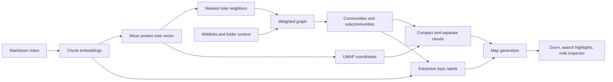

# Atlas implementation audit

Inspected October 2, 2026. Research only; application code was not changed. This is a product-oriented code inspection, not an exhaustive correctness review or performance benchmark.

## What was inspected

- [Map route](../../src/routes/map/+page.svelte): rendering, interaction, inspectors, opening notes, search controls.
- [AtlasStore](../../src/lib/features/atlas/atlasStore.svelte.ts): selection, zoom, display filtering, search, refresh.
- [Atlas contract](../../src/lib/types/atlas.ts).
- [Backend Atlas](../../src-tauri/src/semantic/atlas.rs): graph, clustering, geometry, publication, search.
- [Label generation](../../src-tauri/src/semantic/atlas_labels.rs).
- [Embedding storage](../../src-tauri/src/semantic/db.rs) and [provider](../../src-tauri/src/semantic/embed.rs).
- [Navigation tests](../../e2e/specs/browser/map-navigation.spec.ts), [AtlasStore tests](../../src/lib/features/atlas/atlasStore.test.ts), README, domain/architecture instructions, and tag behavior invariants.
- The running `/Applications/Gneauxghts.app`: map overview, scroll zoom, and an `onboarding` search. The installed binary was not matched to a source revision. Screenshots established broad presentation behavior, not that every current source behavior exists in that binary. Attempts to pick a dot/cloud through UI automation did not expose a selection inspector; conclusions about inspector capabilities below come from source. No note content was edited. Search was cleared and the map fitted afterward.

## Actual pipeline

This is an automatically generated semantic browser. It is not currently a manual whiteboard, an editable taxonomy, or an interface for operating on a selected set of notes.

### Representation and retrieval

`db.rs` persists each note embedding with `mean_pool(embeddings)` from its chunks. Atlas loads these vectors, then builds approximate cosine nearest neighbors with HNSW, normally up to 24 neighbors per note. It has exact-search fallbacks. Similarity edges start at cosine 0.30, are rescaled into display strength, and receive a small same-folder boost; authored wikilinks get their own link kind and weight. These are implementation choices, not measured relevance guarantees. Source: `store_note` embedding publication in `db.rs`; `build_hnsw_knn_rows`, `collect_links`, `normalize_edge_strength`, and `boost_links` in `atlas.rs`.

The provider is local Jina through llama-server, with in-app runtime/model setup. The README makes setup optional. A useful first map therefore depends on installing the local search runtime and indexing eligible content. Source: [README local search](../../README.md), `embed.rs`.

**Implication:** a long journal covering several ideas is collapsed to one vector and one dot. Short, focused notes should be an easier input than mixed journals, meeting notes, and project omnibus documents. This is an inference from representation; relevance on real vaults was not measured. Do not solve it by immediately displaying every chunk as a dot: that exchanges dilution for a much larger navigation problem. Prefer section evidence and alternative topic memberships first.

### Communities and positions

Atlas uses connected components, Leiden community partitioning, group merging, and child-community detection. Top clouds require at least three notes; several thresholds and heuristics govern subdivision and promotion. Clustering operates on a graph derived from higher-dimensional similarities and wikilinks, before 2D presentation. It is not simply clustering screen coordinates. Source: `assign_clouds`, `partition_by_content`, `leiden_partition_group`, `detect_child_communities`.

UMAP initializes from previously cached coordinates; uncached notes can start near existing neighbors. Atlas then normalizes the embedding, compacts cloud members, places top-level clouds, enforces gaps/non-overlap, and separates children. This deliberately readable island layout changes geometric distances beyond the dimensionality reduction itself. Source: `place_uncached_nodes_from_neighbors`, `apply_umap_layout`, `apply_normalized_embedding`, `separate_umap_clouds`, `place_top_level_clouds`.

**Implication:** nearby notes are useful exploration candidates, but screen distance is not a quantitative measurement of relatedness. Empty space between islands is partly a layout decision. A user cannot infer that a topic is twice as different because it is twice as far away.

**Stability concern:** cached initialization helps, but rebuilding still optimizes and repacks the map. Cloud IDs are assigned ordinally (`cloud-1`, etc.) after ranking groups; colors hash those IDs. A content change that changes ranking or partitioning can change topic identity/color/location. The frontend retains a selected cloud when the same string ID exists in a replacement response, without checking semantic membership continuity. This is a concrete code risk; its frequency and magnitude were not measured. Source: `assign_clouds`, `cloud_color`, `AtlasStore.refresh`.

Coordinates are cached by note path; durable `noteId` is a separate contract field. Any future stability work should use existing Note Identity and preserve the current architecture owners, rather than creating another canonical note store.

### Labels

Labels are generated progressively with chunk-based KeyBERT-style candidate extraction and embedding ranking, with representative note-title fallbacks. Structural and label generations are separate; cached label validity includes membership/model/algorithm evidence. Labels are neither authored category names nor an LLM establishing a conceptual ontology. Source: `atlas_labels.rs`, `build_cloud`, structural/label publication in `atlas.rs`.

**Implication:** local extractive labels are cheap and grounded in available text, but a shared word can name a heterogeneous group poorly. There is currently no user rename, reject-membership, merge, or split UI. Showing a fallback provenance is useful; it does not make the label useful.

### Rendering and selection

The overview shows clouds and note dots. More titles appear at nearer zoom; close zoom shows all titles. Note labels truncate at 24 characters, cloud labels at 22. Representative labels favor high-centrality notes. The current route has no explicit title collision-resolution layer. The installed app displayed overlapping and truncated labels after zooming. Source: `buildLayers`, label functions, installed app observation.

Links are suppressed in unselected far/mid overviews and filtered at other zooms. This helps avoid a fully connected hairball. Focusing/hovering a note reveals selected edges; the inspector separately lists wikilinks and semantic edges. Source: `AtlasStore.visibleLinks`, `selectedNodeLinkedNotes`.

Selection is one `selectedNodeId` and one `selectedCloudId`. A node inspector provides a short preview, metadata, tags, and related-note navigation. A cloud inspector provides label, count, density, provenance status, close, and focus. It does not enumerate members. The user can open a note by double click or Enter, which navigates to the editor route. Source: map route handlers/inspectors and AtlasStore selection methods.

**Missing for the stated product intent:** readable cloud contents, multi-select, lasso, selection basket, batch tag/collect/compare, open a reviewed set in the workspace, or create an outline/context bundle from it. Visibility of many dots is not simultaneous interaction with many notes.

There is no explicit persisted camera/history/back-stack in this route: mount fits the map again. A useful spatial browsing session should retain its viewport when returning from the editor, and semantic hops need a visible way back. This is a route inspection, not a full audit of browser session restoration.

### Search

Search blends meaning, lexical presentation text, structural matches, recency, and frequency. Lexical inputs are title, filename, relative path, preview, and tags; they are not an exact scan of every body word. If query embedding fails, it falls back to lexical/activity scoring and reports that in the response. Source: `search_vault_atlas`.

Tag queries filter eligibility and highlight existing positions. They intentionally do not regroup notes. Source: [tag invariants](../../docs/architecture/behavior-invariants.md) and README.

The map route highlights matching nodes/clouds in place; it does not provide a ranked result list or explicit result count. Matching titles depend on score/zoom. The installed app's `onboarding` search left bright relationship lines across dimmed nodes, and results could lie outside the zoomed viewport. Source: `buildLayers`, AtlasStore search-display methods, installed app observation.

**Implication:** preserving geography is sensible, but fast retrieval needs an alternative readable results panel, result count, and next/previous/focus-match navigation. Searching the map should not require hunting for bright pixels. Also distinguish semantic search from exact body search in expectations.

### Scores and trust

`importance` is `0.72 * centrality + 0.28 * degree / 24`, clamped. `centrality` is normalized summed edge strength. The UI displays this as an Importance percentage. This measures connectivity under this graph, not owner-assigned value, quality, novelty, evidence strength, or probability that a note matters. Dot size is likewise based on centrality. Source: `apply_centrality`, node serialization, note inspector.

Semantic percentages display rescaled link strength; same-folder boosts can alter it. They are not calibrated confidence/probability. Cloud density counts internal edges over possible pairs, and semantic/wikilink edge kinds can both contribute. A density percentage has no established user decision attached. Source: `normalize_edge_strength`, `boost_links`, `cloud_density`, inspector markup.

**Recommendation:** remove those numerical claims from the primary UI, or name them plainly and explain them only when useful. Show evidence snippets and relationship type. Similar prose, explicit link, shared project, and relevant-to-this-task are different relations.

### Availability, scale, and accessibility

Generations publish in the background; stale usable map generations can remain available while replacement is built, and labels progress independently. The frontend polls pending responses and avoids obsolete search completion. These support continuity and should be retained. Source: generation publication/read paths and AtlasStore refresh/search logic.

All response nodes remain in `visibleNodes`; the frontend is not a viewport-paged semantic catalog. HNSW and GPU rendering are sensible scale choices, but no measured claim about interactive performance at 1k/10k notes follows from their presence. Measure warm/cold build, indexing lag, labels, frame time, memory, and interaction latency on representative vaults/hardware.

The accessibility tree exposed page controls but no dot/cloud inventory. Keyboard handlers offer zoom, fit, Escape, and opening an already selected note, rather than navigation through the whole collection. A linked list/tree view is an important equivalent access path and also solves readable browsing for mouse users. Source: route markup/handlers, installed accessibility tree. This was not a full assistive-technology audit.

## Product assessment

The foundation already does substantial automatic discovery work. The weakest part is the step from discovery to a reviewed, reusable set of notes. Invest there before adding visual effects or more clustering parameters. Stable landmarks, legible members, content evidence, and a reversible save-set action would test the actual product promise much more directly.
